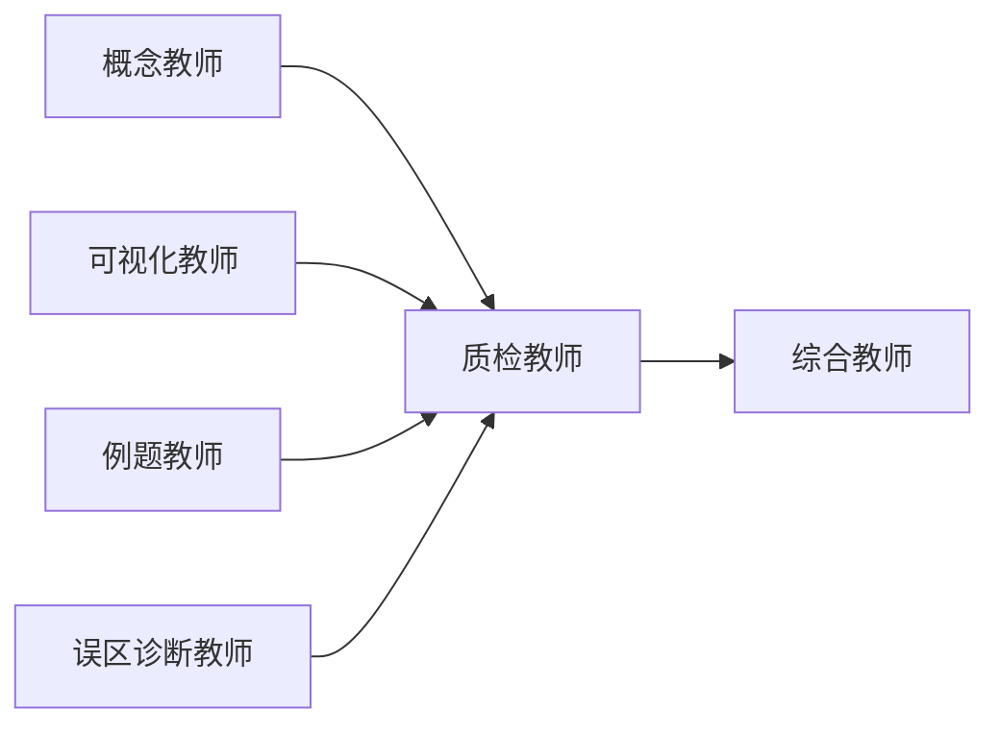

# 多教师DAG：提示词库、组合实验与信任链接口

本轮在现有LangGraph保护主线的“教学生成”位置接入独立教师子图。**增加教师角色不等于增加真实独立模型；默认使用离线接口样例，不声称教学效果提升。**

更新：标准教师批次现在启用合法签名消息的内容交接校验、受阻后的可信离线降级，并把节点/边决策写入 SQLite 审计表。版本化的系统提示词与教学技能配置从可信 YAML 导入同一数据库，再由运行时读回并核验哈希。被污染教师与双教师协调假结论的离线和真实 MiMo 开发对照、效果及边界见 [多智能体教学污染靶场](../research/cgc/TEACHER_POLLUTION_LAB.md)。历史直接命令继续兼容；新实验优先从 `run.cmd experiments` 浏览。

## 先使用

在Windows项目 `D:\pycharm\CogniGuard` 中运行：

```powershell
# 列出10类教师、20个提示词版本和6种组合
.\.venv-langgraph\Scripts\python.exe -m core.langgraph_runtime teachers --list

# 跑一次多教师会诊的离线接线验证，输出目录必须不存在
.\.venv-langgraph\Scripts\python.exe -m core.langgraph_runtime teachers --team committee --output experiments/results/my_teacher_committee

# 导出真实编译图的Mermaid
.\.venv-langgraph\Scripts\python.exe -m core.langgraph_runtime graph --kind teachers --team committee

# 跑6种组合×2种链策略，默认样例3题；不调用真实模型
.\.venv-langgraph\Scripts\python.exe -m core.langgraph_runtime matrix --plan configs/teacher-dag-experiments.yaml --execute --output experiments/results/my_teacher_matrix
```

省略矩阵命令的 `--execute` 时只校验和生成计划。LangSmith仍默认关闭；单组合命令可显式加 `--langsmith`，仅导出白名单数值span，需先在本机配置密钥。矩阵外层默认只导出调度span，教师的完整本地数值trace保存在制品中。

## 修改哪个文件

- `configs/teacher-prompts.yaml`：教师职责、v1/v2系统提示词。
- `configs/teacher-skills.yaml`：10类教学 Agent 的版本化技能指令；不是 Codex 自身的技能目录。
- `configs/teacher-teams.yaml`：教师实例、提示词版本、模型绑定名、可读字段、DAG边和输出节点。
- `configs/teacher-dag-experiments.yaml`：组合、链策略、种子和并发的实验矩阵。
- `core/langgraph_runtime/teachers/`：提示词/拓扑校验、教师后端、图执行、交接链与结果记录。

这些是**可信应用配置**，不能从学生题目、参考资料或教师生成内容中反序列化。YAML不允许导入任意Python代码、指定工具权限或嵌入评分标签/API密钥。

## 教师池与策略版本

概念教师：v1建立直觉，v2用正反例澄清边界。

例题教师：v1分步推导，v2示范后迁移。

苏格拉底教师：v1递进提问，v2分层提示。

误区诊断教师：v1依据证据诊断，v2错误/正确推理对照。

推导核验教师：v1复算与条件核验，v2边界条件和反例。

可视化教师：v1空间/图形解释，v2文字—公式—图形表征转换。

分层教学教师：v1基础—标准—拓展，v2针对可见困难补救。

评测教师：v1形成性评价，v2迁移评价。

质检教师：v1准确性/完整性/披露必要性检查，v2处理教师意见冲突。

综合教师：v1简明整合，v2先处理分歧再整合。

系统提示词只来自可信库；任务、受控资源和上游教师消息全部留在数据载荷中，不能拼接成新的system消息。运行时附加固定边界提示，并记录**包含固定边界在内**的有效系统提示词哈希。

实际JSON模型载荷中的上游消息只含发送实例、正文及不可信数据边界。随机message ID、签名验证状态和哈希留在控制面/本地记录，不注入教师提示，避免给组合对比增加无关随机输入或把认证状态误当成内容可信度。

## 六种组合

- `solo`：概念教师单独回答，作为教师数量对照。
- `serial_coaching`：概念 → 例题 → 综合。
- `dual_teachers`：概念与苏格拉底并行 → 综合。
- `committee`：概念、可视化、例题、误区诊断并行 → 质检 → 综合。
- `differentiated`：误区诊断 → 苏格拉底与分层教师并行 → 评测 → 综合。
- `cross_checked`：例题 → 推导核验；概念与核验结果共同进入质检 → 综合。这是不同深度分支的汇合用例。



每个实例有独立node ID，同一角色可以出现多次并使用不同提示词版本，不是只能从十个角色中各选一次。

所有前驱都会执行（包括产生blocked收据的节点）；汇合使用LangGraph的 `add_edge([前驱...], 目标)` AND屏障，而不是多个普通入边，避免长短分支导致提前或重复汇合。图会拒绝环、重复边、未知教师、孤立分支与不参与最终输出的节点。依据：[LangGraph多分支汇合说明](https://docs.langchain.com/oss/python/langgraph/use-graph-api#defer-node-execution)。

## 怎样搭配新的教师

在 `teacher-teams.yaml` 的 `teams` 下新增：

```yaml
two_styles:
  nodes:
    - id: intuitive
      teacher: concept
      prompt: v1
      view_fields: [question, knowledge, difficulty]
    - id: contrastive
      teacher: concept
      prompt: v2
      view_fields: [question, knowledge, difficulty]
    - id: synthesize
      teacher: synthesis
      prompt: v2
      view_fields: [question, knowledge, difficulty]
  edges:
    - {source: intuitive, target: synthesize, max_chars: 1600}
    - {source: contrastive, target: synthesize, max_chars: 1600}
  output: synthesize
```

然后执行 `teachers --team two_styles --output ...`，或在矩阵的 `teams` 列表中加入 `two_styles`。修改提示词时优先增加版本，避免覆写已用于实验的版本；即使保留旧版本名，内容SHA变化也会被记录。

计划展开时冻结提示词库和组合库的SHA；运行前发生漂移会拒绝执行，防止同一矩阵中的组合悄悄换了一套提示词。

## 不同模型的绑定

`backend`是可信代码注册的名字，不是API密钥或任意Python路径。默认节点绑定 `default`，由离线fixture提供。

程序化接入你已有的JsonModel：

```python
from core.langgraph_runtime.teachers import PromptLibrary, TeamCatalog
from core.langgraph_runtime.teachers import TeacherDAGGenerator, JsonTeacherBackend
from core.langgraph_runtime import LangGraphProtectionPipeline

library = PromptLibrary("configs/teacher-prompts.yaml")
team = TeamCatalog("configs/teacher-teams.yaml", library).get("committee")

# model_a/model_b是你已安全配置的JsonModel实例；调用下面的pipeline.run才会发请求。
# 把某个质检节点的backend设为review_model，可使用不同模型。
teachers = TeacherDAGGenerator(team, library,
    backends={"default": JsonTeacherBackend(model_a),
              "review_model": JsonTeacherBackend(model_b)})
pipeline = LangGraphProtectionPipeline(config, resources, generator=teachers)
result = pipeline.run(profile, question, access=trusted_scope)
```

本轮CLI矩阵只接离线fixture，且只注册 `default` 绑定；自定义绑定需按上述程序化方式提供，未绑定会在调用前拒绝。真实多模型矩阵尚未执行。模型后端只得到该教师获准的 `TeachingInput` 字段和显式上游消息，不拿原始画像、教师资源对象或工具执行器。JSON返回值只能包含answer字符串；工具、角色或权限字段会导致拒绝。

## 交接边界与信任链

每次子图运行生成随机run ID及独立HMAC密钥，密钥不进入提示词、图状态、trace或制品。消息绑定run、图配置、发送实例、有效提示词哈希、父消息、hop、数据标签和内容哈希。

每条边检查：

- 发送者与配置边匹配，消息属于当前run与图。
- 有效提示词绑定与签名一致；修改正文、父消息或标签会使签名失败。
- 同一消息不能在同一目标重复交付；跨run消息不能重放。
- `allowed_labels`和目标节点的 `upstream_labels`共同限制传播范围。
- 按边的 `max_chars`裁剪披露，并分别记录原消息与实际交付内容的哈希。

逐边记录中的 `issued_content_hash`是控制器最初签发的正文，`source_content_hash`是链检查收到的未裁剪正文，`delivered_content_hash`是实际交给下游的正文。这三个哈希用于事后分析；最初签发版本的对照哈希不回灌到链决策作为攻击标签。

数据标签是控制器按可见输入保守推导的 `task`、`minimized_profile`、`controlled_resource`，不是教师自己声明。下游输出继承已消费消息的标签。它用于追踪可能的数据来源，**不是实际泄露测量**；即使模型没有复述某段资料，也可能保留其标签。

`view_fields`控制直接读取的基础字段，不能代替上游传播策略。例如要禁止某个综合教师接收画像派生信息，可以设置 `upstream_labels: [task, controlled_resource]`；若它的前驱读取过最小任务卡，链路会报告 `data_scope_denied`。

记录区分 `origin_valid`、`signature_valid`、`scope_allowed`和 `chain_valid`。来源正确但范围未获准仍会被拒绝。所有交付视图恒为 `boundary: untrusted_data`、`instruction_permission: false`。

`enforce`下不符合链策略的交接被拒绝；节点默认 `requires_all_inputs: true`，缺少一个前驱就不调用该教师，阻断会沿依赖传播到输出。

`observe_only`是明确的研究对照：记录格式有效且在配置边上的违规消息，但允许继续传递，保留 `lineage_valid: false`，不会在下一跳洗成有效祖先。格式错误或不在DAG中的边仍不允许。**这不是安全部署模式。**两种模式都不关闭原始画像访问门限，也不提供额外工具权限。

## 后续攻防实验的插入点

消息干预在可信实验代码中注入，不在YAML、题目或教师输出中执行：

```python
from dataclasses import replace

def simulate_tamper(source, target, message):
    if source == "concept" and target == "worked":
        return replace(message, text=message.text + " [SIMULATED_TAMPER]")
    return message

generator = TeacherDAGGenerator(team, library,
    trust_mode="enforce", delivery_transform=simulate_tamper)
```

之后可固定老师组合、模型和样本，仅切换干预边和链策略，测到达率、后续再传播、实际敏感内容交付、正常任务可用、调用次数与延迟。攻击目标、is_attack、预期动作与评分gold必须留在独立评估器，不能混入教师视图或链决策。

**重要边界：**HMAC验证的是当前可信运行时签发的来源/完整性，不是语义正确性或注入检测。被攻陷的教师正常产出恶意文本，仍可能拥有有效来源签名；这正是之后需要单独评估的攻击类别。签名不能替代语义检测、权限门控与实际输出检查，也不能抵御签名运行时或主机本身被攻陷。

当前链是单次DAG调用内的本地链，不是跨进程认证协议、持久化跨轮信任评分或安全性证明。没有引入此前暂缓的全局风险状态推断新模型。

## 留下什么实验材料

每个worker保存：

- `manifest.json`：组合/提示词版本与有效哈希、输入哈希、字段范围、种子与依赖。
- `teacher-transcripts.json`：每位教师的本地输出、父消息、标签及逐边允许/拒绝理由。
- `node-traces.json`：原保护图的内容无关数值trace。
- 教师transcript内部的 `trace`：各教师耗时、索引、入边数、阻断数等。
- `rows.json`、`summary.json`、`dag.mermaid.json`：结果、工程计数与真实图结构。

本地transcript包含教师文本，不能当作脱敏日志直接上传。LangSmith仅接白名单数字，teacher_index可在本地manifest对应回教师。`model_calls`为标记real_model的后端逻辑调用计数，不是HTTP重试次数或token账单。

默认6组合×2模式×3样例用于接线验收。比较真实教学效果时，需控制不同教师数量导致的总token、延迟与调用预算差异，单独设计效用、传播与隐私指标；不能把fixture回答、签名成功或节点数多解释成教学/安全收益。
