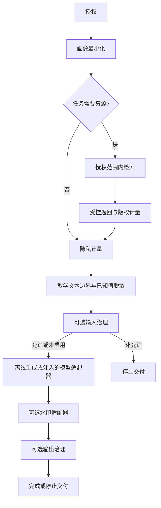

# CogniGuard LangGraph 实验框架

2026-10-13：新增可选执行层。历史入口、领域算法和既有实验结果保留，未替换默认 `main.py`，未升级历史 `.venv`。仅在现有 `.gitignore` 和 `pytest.ini` 中补充新环境的排除项，保留原有内容。

## 已实现与迁移边界

后续同日新增：教学侧已有10角色、20提示词版本与6种可配置教师DAG，支持组合矩阵与逐边信任链控制；详见 [TEACHER_DAG.md](../design/TEACHER_DAG.md)。原focused攻击runner内部仍未全面替换。

外部攻击数据与原生/迁移双轨评测见 [EXTERNAL_ATTACK_BENCHMARKS.md](../research/benchmarks/EXTERNAL_ATTACK_BENCHMARKS.md)。已接入固定InjecAgent与公开HF来源；真实攻击成绩与离线接线计数严格分开。

新增 `core/langgraph_runtime/`，包括细粒度保护图、实验调度图、版本化对比/消融配置、适配器、内容隔离追踪和测试。

- 默认保护主线已经以真实 `StateGraph` 节点运行，不是把整个旧 `run()` 套进一个节点。
- 复用原有 `ProfileSelector`、`CopyrightAwareRetriever`、`ExposureBudget`、`PrivacyBudgetLedger` 与 `TeachingInput`，不重写领域算法。
- 默认 parity 模式与旧主线保持语义一致；可显式接入现有 `LifecycleGuard`。它仍是既有规则控制，不是此前暂缓的全局风险推断新算法。
- 提供 `JsonTeachingAdapter` 和 `SelectiveHSWSTAdapter`，但本次只验证适配器契约与失败分支，没有实际调用付费模型或加载水印权重。默认水印明确标记关闭。
- 11类已有 focused 实验可由统一调度器通过子进程调用。它们的内部多轮、工具和评分流程仍是历史实现，没有冒称已经全部改写成细粒度子图。
- 旧 CG pilot 的标签泄漏和 oracle 问题不会因为换框架自动消失；本次没有修改其评价协议。

## 在Windows运行

在 `D:\pycharm\CogniGuard` 下使用新环境：

```powershell
.\.venv-langgraph\Scripts\python.exe -m core.langgraph_runtime demo
.\.venv-langgraph\Scripts\python.exe -m core.langgraph_runtime demo --governance
.\.venv-langgraph\Scripts\python.exe -m pytest core/langgraph_runtime/tests -q
```

新环境已安装；另附 `requirements-langgraph-lock.txt` 记录本轮完整依赖版本（Windows Python 3.12），它是版本锁，不是wheel哈希锁。

只生成实验计划：

```powershell
.\.venv-langgraph\Scripts\python.exe -m core.langgraph_runtime matrix --output experiments/results/my_langgraph_plan
```

执行默认配置中的离线对比/消融，其他四类模型实验仅dry-run：

```powershell
.\.venv-langgraph\Scripts\python.exe -m core.langgraph_runtime matrix --execute --output experiments/results/my_langgraph_validation
```

输出目录必须不存在，不会覆盖或清空既有结果。默认计划在 `configs/langgraph-experiments.yaml`，包含旧主线参考、图主线一致性、增强完整版本和三个组件移除，以及teaching/multiagent/toolgov/memorypoison的dry-run。硬性访问策略不是消融开关。

真实模型实验须同时满足：计划中 `dry_run: false`、命令使用 `--execute --allow-model-calls`。本次未运行该路径；旧模型适配器继续在原 `.venv` 下运行，避免新依赖改变历史环境。

## 保护图



查看由真实编译图生成的Mermaid：

```powershell
.\.venv-langgraph\Scripts\python.exe -m core.langgraph_runtime graph
.\.venv-langgraph\Scripts\python.exe -m core.langgraph_runtime graph --kind experiments
```

一个 `LangGraphProtectionPipeline` 实例对应一个授权学生会话。同会话预算跨轮累计；不同学生必须创建新实例；并发调用由会话锁串行化，避免预算竞态。

默认输出仍是原 `ProtectionResult`。注入自定义生成/水印适配器后，输出标记 `adapter_supplied`，不伪装成离线规则生成。

## 运行时数据边界

图状态只包含随机运行ID、节点名、计数、预算数值和布尔状态。画像、问题、资源、候选、教学文本和回答保存在单次调用的 `Runtime` context中，不进入图状态通道。

这里没有把“private channel”误当作脱敏；原生自动追踪会被 `tracing_context(enabled=False)` 关闭，另行导出白名单指标。不要绕过包装器直接对裸图增加外部回调或持久化器。

原始 `ProtectionResult` 和离线评估的rows是**本地诊断产物**，不是可上传的脱敏记录。监控导出器只接受 `SafeTelemetry`。

为保留历史语义，parity模式的领域预算提交位置与旧流程相同。可选治理拒绝后不返还已计量预算，失败也不自动重试。这是保守计量，不是已经实现事务回滚。尚未执行领域变换适配器时，`sanitize/degrade` 与其他非allow决策均停止交付。

## 实验调度与复现

调度图为：校验计划 → 隔离子进程执行 → 归集制品哈希。

- YAML schema拒绝未知字段；运行时计划不接受 `attack_indicators`、`expected_action`、`oracle` 或API密钥。
- pipeline子进程在Python启动前设置 `PYTHONHASHSEED`，并固定 `random` 种子，避免增强画像中的 `hash()` 特征跨解释器漂移。
- 旧focused适配器保留自身随机协议；除InjecAgent显式传seed外，不能仅凭统一计划的seed宣称其所有内部随机源已冻结。
- manifest记录计划哈希、代码哈希、依赖版本；worker另记录输入哈希、有效配置和预算作用域。
- 每题独立预算；不同seed、对比和消融各用独立解释器。
- 一致性比较只排除 `result.source_trace.timestamp`，保留实际内容、选择、预算、其他来源字段和指标。不同输入哈希不被视为同组配对。
- 不合并不同实验的ASR，不用这批离线样例重报论文性能。

最终验证产物在 `experiments/results/langgraph_refactor_validation_20261013_02/`。本轮实际完成6个离线配置与4个dry-run计划；旧/新主线在3个默认样例上一致，忽略的仅是资源来源时间戳。

## LangSmith：可选、指标模式

默认关闭，不读取项目 `.env` 来自动启用监控。已有 `LANGSMITH_TRACING=true` 也不会让本包装器自动上传原始图内容。

在本机安全配置 `LANGSMITH_API_KEY` 后，可给 `demo`、`matrix`、`teachers` 或 `tools run` 加 `--langsmith`。看板、自由问答、课堂、受保护多 Agent 和研究流还可在运行进程设置 `COGNIGUARD_LANGSMITH_ENABLED=1`，导出节点级安全记录。项目默认为 `cogniguard-langgraph`，可由 `COGNIGUARD_LANGSMITH_PROJECT` 指定。不要把密钥写进 YAML、数据集、截图或聊天。

```powershell
# 先在本机安全设置 LANGSMITH_API_KEY，再运行：
.\.venv-langgraph\Scripts\python.exe -m core.langgraph_runtime demo --langsmith
.\.venv-langgraph\Scripts\python.exe -m core.langgraph_runtime langsmith status
.\.venv-langgraph\Scripts\python.exe -m core.langgraph_runtime langsmith smoke
# 只有显式 --submit 才向云端发送一个合成的 metrics-only span：
.\.venv-langgraph\Scripts\python.exe -m core.langgraph_runtime langsmith smoke --submit
```

Windows 用户可在 PowerShell 运行 `scripts\launch_langsmith.ps1 -Mode smoke`；脚本隐藏密钥输入并只注入当前进程，`-Mode demo` 或 `-Mode serve -Port 8000` 可启动实际后端监控。无密钥时后端不会因监控配置中断，状态为 `credential_missing`。`langsmith status` 只报告密钥是否存在，不输出密钥值。

导出的是完成后的根运行与子节点span，包含耗时、节点成功/失败、选择数、候选数、预算前后、是否阻断、是否启用治理/水印等。它不是实时token级流式追踪。

输入、输出设为空；元数据仅白名单数值；不上传问题、画像、资源、答案、原始异常/堆栈、路径、模型请求头或学生ID。决策编码：allow=0，sanitize=1，degrade=2，quarantine=3，refuse=4，block=5。监控传输失败不会改变保护决定，状态为 `export_failed`。

已测试真实 LangSmith SDK 的序列化契约，HTTP 传输替换为本地 mock；后端节点监控还验证异常详情不进入上传记录。远端目前没有 `LANGSMITH_API_KEY`，所以“接入代码可用”和“云端页面已收到运行”在这里明确区分，后者尚未验证。嵌套子图以独立安全运行记录导出，并非原生全文 trace 树。

## 注入实际模型与水印

```python
from core.langgraph_runtime import LangGraphProtectionPipeline
from core.langgraph_runtime.adapters import JsonTeachingAdapter

# model为你已配置的可信JsonModel实例；构造adapter不会自行请求API。
pipeline = LangGraphProtectionPipeline(config, resources,
                                       generator=JsonTeachingAdapter(model))
result = pipeline.run(profile, question, access=trusted_access_scope)
```

生成适配器只能接收 `TeachingInput` 文本视图；模型输出中的工具请求不会自动执行。已有攻击实验的工具治理不因此被替换，仍由其原runner执行。

`SelectiveHSWSTAdapter` 接受已有 `rewrite_sample`、关键片段抽取函数和检测函数；调用full改写，检查占位符/保真/fallback，且要求检测返回 `detected=True` 及有限z分数。它拒绝将普通API改写称为logits KGW水印。该接点需在具备torch/transformers与既有模型权重的环境中配置；本次没有下载或加载模型。

## 下一阶段，不能提前声称完成

1. 将focused多轮/多Agent runner内部逐步迁移为子图，保留原评分协议并增加逐轮配对回归。
2. 做真实模型与真实HSW-ST权重的端到端接线验收；新增依赖与重跑成本单独控制。
3. 为领域预算提交、工具调用、审计与输出建立事务/幂等键，再启用checkpoint和断点恢复；现在明确 `checkpointer=False`、无自动重试，避免重放重复扣账或执行。
4. 配置LangSmith项目后，用合成样例验证实际云端收件和数据白名单。
5. 另开无污染评价修复工作；重构不替代CG oracle和标签泄漏审计。

实现依据：[LangGraph Graph API](https://docs.langchain.com/oss/python/langgraph/graph-api)、[LangSmith数据隐藏](https://docs.langchain.com/langsmith/mask-inputs-outputs)、[程序化追踪开关](https://docs.langchain.com/langsmith/trace-without-env-vars)。
