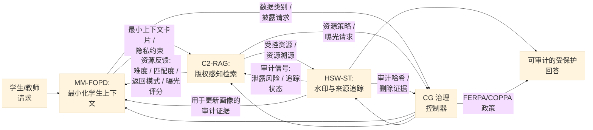

# CogniGuard 两周实验进展组会 

> 汇报主题：从“单机制有效”到“三机制闭环协同有效”的实验验证  
> 项目：CogniGuard 教育场景隐私、版权与审计协同保护平台  
> 汇报重点：数据集扩展、baseline/消融、多重采样、闭环反馈、交叉层协同、攻击实验展示

## 1. 一句话总结

这两周主要工作是把 CogniGuard 的实验从早期 3 条 demo 样例扩展为可复现的多数据集实验，并补充了两类关键证据：

1. [三机制联合实验](#joint-synergy) 证明 Full CogniGuard+CG 优于单机制和双机制组合。
2. [闭环反馈实验](#feedback-loop-eval) 和 [交叉层协同实验](#cross-layer-eval) 证明系统不是简单线性加权，而是存在真实反馈路径和正向交互增益。

当前可以支撑论文主结论：

> CogniGuard 通过 [MM-FOPD](#mm-fopd)、[C2-RAG](#c2-rag)、[HSW-ST](#hsw-st) 与 [CG](#cg) 横向治理控制，实现学生画像最小披露、教师资源版权控制、生成内容可追溯审计，以及跨层风险闭环协同。

## 2. 本阶段完成内容

| 模块 | 本阶段工作 | 产出 |
|---|---|---|
| 数据集 | 从 3 条 demo 扩展到开放数学题数据包 | [GSM8K](#gsm8k)、[AQuA-RAT](#aqua-rat)、[TheoremQA](#theoremqa)，共 240 题混合集 |
| 单机制评估 | FOPD、C2-RAG、HSW-ST 分别评估 | 隐私泄露、版权泄露、审计失败指标 |
| baseline 对比 | 增加隐私保护和版权保护 baseline | PII-Redaction、RBAC-only、MemFree、SHIELD-Agent 等 |
| 组件消融 | 对 FOPD、C2-RAG、三机制组合做消融 | 证明不是单个组件偶然造成效果 |
| 联合协同 | 对单机制、双机制、Full、Full+CG 比较 | Full+CG 显著降低 [JointRisk](#jointrisk) |
| 多重采样 | 随机采样超参数和指标权重 | 95% bootstrap CI，验证结论稳健 |
| 闭环反馈 | 验证 FOPD/C2-RAG/HSW-ST/CG 是否真的互相影响 | 检索变化率、返回模式降级率、跨层拦截率 |
| 交叉层协同 | 引入非线性交叉指标 | 证明三机制组合低于独立作用期望风险 |
| 攻击实验 | 整理隐私、版权、提示注入、水印扰动、跨层攻击展示方式 | 形成攻击面覆盖表和攻击指标体系 |

## 3. 系统机制流程



补充说明：C2-RAG 并不是只接收 MM-FOPD 的 `context_card`，它还会把 `resource_difficulty`、`resource_fit_score`、`return_mode`、`exposure_score` 等 ResourceFeedback 回传给 MM-FOPD，用于后续画像更新、教学策略调整和下一轮最小上下文选择。

核心逻辑：

- [MM-FOPD](#mm-fopd) 负责“学生画像只披露最小必要上下文”。
- [C2-RAG](#c2-rag) 负责“教师资源不能被原文重构”。
- [HSW-ST](#hsw-st) 负责“生成内容和资源来源可追溯、可审计”。
- [CG](#cg) 不是第四个主创新机制，而是横向治理控制器，负责跨层策略约束。

## 4. 数据集扩展

新增数据集目录：

```text
experiments/datasets/cogniguard_math_suite/
```

| 数据包 | 来源 | 规模 | 作用 |
|---|---:|---:|---|
| `junior_math_gsm8k` | [GSM8K](#gsm8k) | 80 题 | 基础/初中衔接数学推理 |
| `high_school_aqua` | [AQuA-RAT](#aqua-rat) | 80 题 | 高中代数与应用题推理 |
| `college_theoremqa` | [TheoremQA](#theoremqa) | 80 题 | 大学数学/定理驱动问题 |
| `mixed_math_suite` | 三者混合 | 240 题 | 主实验数据集 |

每个数据包都被转换为 CogniGuard 可直接读取的三份文件：

```text
student_profile/data/student_questions.jsonl
student_profile/data/profiles.jsonl
teacher_resource/data/teacher_resources.jsonl
```

构造命令：

```bash
python -m experiments.dataset_builders.build_math_datasets --seed 2026
```

## 5. 联合协同实验结果 <a id="joint-synergy"></a>

实验脚本：

```bash
python -m experiments.evaluation.eval_joint_synergy \
  --results-root experiments/results/joint_synergy_mixed_math \
  --student-data-root experiments/datasets/cogniguard_math_suite/mixed_math_suite/student_profile/data \
  --teacher-data-root experiments/datasets/cogniguard_math_suite/mixed_math_suite/teacher_resource/data
```

关键结果：

| 方法 | JointRisk 越低越好 | 说明 |
|---|---:|---|
| None | 1.0000 | 无保护 |
| Best Single: FOPD-only | 0.6218 | 单机制最优 |
| Best Pair: FOPD+HSWST | 0.3568 | 双机制最优 |
| Full CogniGuard w/o CG | 0.1519 | 三机制联合 |
| Full CogniGuard+CG | 0.1244 | 三机制 + 横向治理 |

联合增益：

| 指标 | 数值 |
|---|---:|
| [synergy_gain_vs_best_pair](#synergy-gain) | 0.2325 |
| [cg_gain](#cg-gain) | 0.0275 |
| Full beats best pair | True |

可视化：


## 6. 多重采样与置信区间

目的：回答“默认权重和默认超参数是不是刚好调出来的”。

实验做法：

- 采样 [FOPD](#mm-fopd) 的 `top_k`、`sensitivity_threshold`、attention temperature、bottleneck 参数。
- 采样 [C2-RAG](#c2-rag) 的 exposure threshold、return-mode threshold、score weights。
- 采样 [JointRisk](#jointrisk) 和 [Utility](#utility) 的指标权重。
- 对采样结果做 [95% bootstrap CI](#bootstrap-ci)。

运行命令：

```bash
python -m experiments.evaluation.eval_joint_synergy_sampling \
  --samples 64 \
  --bootstrap-iterations 1000 \
  --seed 2026
```

关键结果：

| 指标 | 数值 |
|---|---:|
| samples | 64 |
| Full+CG beats best-pair rate | 1.0000 |
| Full+CG beats best-single rate | 1.0000 |
| mean synergy gain vs best pair | 0.1733 |
| mean CG gain | 0.0285 |

可视化：


## 7. 闭环反馈实验 <a id="feedback-loop-eval"></a>

目的：回答“系统是不是真的协同，还是只是三个模块并排运行”。

实验脚本：

```bash
python -m experiments.evaluation.eval_feedback_loops \
  --results-root experiments/results/feedback_loops_mixed_math
```

验证的反馈路径：

| 反馈路径 | 验证问题 | 指标 |
|---|---|---|
| FOPD → C2-RAG | `context_card` 是否改变检索结果 | [retrieval_top1_shift_rate](#retrieval-top1-shift-rate) |
| C2-RAG → FOPD | [ResourceFeedback](#resourcefeedback) 是否回流到画像更新和后续上下文选择 | resource_fit_score、resource_difficulty、return_mode、exposure_score |
| HSW-ST → C2-RAG | 泄漏告警是否触发返回模式降级 | [hsw_return_mode_downgrade_rate](#hsw-return-mode-downgrade-rate) |
| CG → 全链路 | 跨层高风险请求是否被拦截 | [cg_cross_layer_block_rate](#cg-cross-layer-block-rate) |
| 闭环整体 | 独立模块风险是否下降 | [closed_loop_cross_layer_risk](#closed-loop-cross-layer-risk) |

关键结果：

| 指标 | 数值 | 解释 |
|---|---:|---|
| `ambiguous_retrieval_top1_shift_rate` | 0.6417 | 弱请求场景下，FOPD context 改变 64.17% 的 C2-RAG Top-1 检索 |
| `hsw_return_mode_downgrade_rate` | 0.7833 | 78.33% 高风险资源输出被 HSW-ST 反馈触发降级 |
| `avg_copyright_leak_delta_from_hsw` | 0.0269 | HSW-ST 反馈后平均版权泄漏下降 |
| `cg_cross_layer_block_rate` | 1.0000 | CG 拦截所有构造的跨层高风险事件 |
| `avg_independent_cross_layer_risk` | 0.6280 | 独立模块风险 |
| `avg_closed_loop_cross_layer_risk` | 0.0108 | 闭环后交叉层风险 |

组会讲法：

> 这组实验说明 CogniGuard 不是简单把三个模块串起来，而是存在实际信息流：FOPD 影响资源检索，HSW-ST 影响资源返回模式，CG 约束跨层数据流。

## 8. 交叉层协同实验 <a id="cross-layer-eval"></a>

目的：回应“是不是只是线性加权平均”的质疑。

实验脚本：

```bash
python -m experiments.evaluation.eval_cross_layer_synergy \
  --results-root experiments/results/cross_layer_synergy_mixed_math
```

本实验不只看独立指标，而是增加交叉项：

- [PrivacyLeak](#privacyleak) × [CopyrightLeak](#copyrightleak)
- [CopyrightLeak](#copyrightleak) × [AuditFailure](#auditfailure)
- [PrivacyLeak](#privacyleak) × [TamperUndetected](#tamperundetected)
- [UnauthorizedAccess](#unauthorizedaccess) × max(PrivacyLeak, CopyrightLeak)

关键结果：

| 指标 | 数值 |
|---|---:|
| Base cross-layer risk | 1.0000 |
| Best pair cross-layer risk | 0.1451 |
| Full w/o CG cross-layer risk | 0.0541 |
| Full+CG cross-layer risk | 0.0456 |
| Independent expectation risk | 0.1876 |
| [interaction_gain](#interaction-gain) vs independence | 0.1421 |
| relative interaction gain | 75.70% |
| CG controller gain | 0.0085 |


> 如果三个机制只是独立起作用，Full 的风险应该接近 independent expectation risk；但实验中 Full+CG 的实际交叉层风险更低，说明三机制之间存在正向交互增益。

## 9. 攻击实验如何展示

建议组会里不要把所有攻击细节堆成大表，而是按攻击面展示。

| 攻击类型 | 攻击目标 | 防护机制 | 主要指标 |
|---|---|---|---|
| 隐私抽取/模型反演 | 学生画像 | [MM-FOPD](#mm-fopd)、[CG](#cg) | [PrivacyLeak](#privacyleak)、[PIILeakFlag](#piileakflag)、[RawProfileSentFlag](#rawprofilesentflag) |
| 版权重构 | 教师资源原文 | [C2-RAG](#c2-rag) | [CopyrightLeak](#copyrightleak)、[CRR](#crr)、[ORR](#orr) |
| 提示注入/越权访问 | Agent 权限边界 | [CG](#cg) | [ASR](#asr)、[BlockRate](#blockrate) |
| 画像污染 | 学生画像更新链 | [MM-FOPD](#mm-fopd)、[CG](#cg) | PoisonAcceptRate、DefenseRate |
| 水印扰动 | 生成内容审计链 | [HSW-ST](#hsw-st) | [WDR](#wdr)、TraceRecoveryRate |
| 交叉层攻击 | 隐私经资源泄露、版权经画像放大 | 三机制 + CG | [CrossLayerAttackRisk](#crosslayerattackrisk)、[interaction_gain](#interaction-gain) |

推荐图表：

1. 攻击类型 × 方法 的 grouped bar chart：展示 ASR 或 Leakage 越低越好。
2. 方法 × 攻击类型 的 heatmap：展示防护覆盖面。
3. 交叉层攻击单独小表：展示 independent expectation 与 observed risk 的差距。

## 10. 论文中可直接使用的实验叙述

可以这样组织实验章节：

1. **基础有效性实验**：分别验证 MM-FOPD、C2-RAG、HSW-ST 对隐私、版权、审计风险的降低作用。
2. **baseline 对比实验**：与隐私脱敏、权限控制、版权检测、MemFree、SHIELD 类方法比较。
3. **组件消融实验**：移除 orthogonal privacy gating、task attention、information bottleneck、exposure budget、variant generation 等组件。
4. **联合协同实验**：比较 None、single、pair、Full、Full+CG。
5. **多重采样与置信区间**：证明结论对超参数和指标权重稳定。
6. **闭环反馈实验**：证明三机制之间存在真实反馈路径。
7. **交叉层协同实验**：证明组合效果超过独立模块期望风险。
8. **攻击实验展示**：覆盖隐私、版权、权限、污染、水印、交叉层攻击。

## 11. 结论

本阶段实验的核心结论可以概括为三句话：

1. **有效**：Full CogniGuard+CG 在 240 题 mixed_math_suite 上将 JointRisk 从 1.0000 降到 0.1244。
2. **稳健**：64 组超参数和指标权重采样中，Full+CG 对 best-pair 和 best-single 的胜率均为 100%。
3. **协同**：闭环反馈和交叉层指标表明，三机制组合不是简单线性相加，而是存在真实反馈路径和正向 interaction gain。

---

# 附录 A：算法概念解释

## MM-FOPD <a id="mm-fopd"></a>

MM-FOPD 指 Multi-Modal Federated Orthogonal Profile Distillation，本项目中用于学生画像隐私保护。核心目标是从完整学生画像中选择“当前教学任务必要的最小上下文”，避免把学校、家庭、身份、原始多模态数据等敏感信息直接发送给下游模型。

相关组件：

- [Orthogonal Privacy Gating](#orthogonal-privacy-gating)
- [Task Attention](#task-attention)
- [Information Bottleneck](#information-bottleneck)
- [Context Card](#context-card)

## Orthogonal Privacy Gating <a id="orthogonal-privacy-gating"></a>

将任务相关特征与敏感特征分离，降低敏感画像字段被选入上下文卡片的概率。实验中对应 FOPD 的 enhanced component ablation。

## Task Attention <a id="task-attention"></a>

根据当前题目、知识点、难度，对学生画像记录分配注意力权重。作用是优先选择与当前任务相关的 mastery、error pattern、preference。

## Information Bottleneck <a id="information-bottleneck"></a>

信息瓶颈思想：在保留任务必要信息的同时压缩非必要画像信息。本项目中用于限制进入 context card 的画像记录数量和敏感信息量。

## Context Card <a id="context-card"></a>

最小上下文卡片。它不是完整学生画像，而是经过 FOPD 选择和脱敏后的任务相关摘要。C2-RAG 可以利用 context card 改善资源检索，但第三方模型不能接收 raw profile。

## C2-RAG <a id="c2-rag"></a>

Copyright-Controlled Retrieval-Augmented Generation。用于教师资源版权保护。它在检索增强生成基础上加入版权等级、曝光预算、返回模式控制和资源溯源，避免模型连续多轮输出后重构教师题库原文。

相关组件：

- [Exposure Budget](#exposure-budget)
- [Return Mode Control](#return-mode-control)
- [Variant Generation](#variant-generation)
- [Resource Provenance](#resource-provenance)

## Exposure Budget <a id="exposure-budget"></a>

累计曝光预算。系统根据输出文本与原资源的 LCS、n-gram overlap、语义相似度和重复访问焦点计算资源曝光程度。曝光越高，C2-RAG 越倾向于从 quote 降级到 summary、outline、variant 或 refuse。

## Return Mode Control <a id="return-mode-control"></a>

C2-RAG 的返回模式控制：

| 模式 | 含义 |
|---|---|
| quote | 允许短引用 |
| summary | 返回摘要 |
| outline | 返回教学提纲 |
| variant | 返回同知识点变式题 |
| refuse | 拒绝继续提供高风险内容 |

## Variant Generation <a id="variant-generation"></a>

生成与原题知识点一致但表面表达不同的变式题，降低原文重构风险。

## Resource Provenance <a id="resource-provenance"></a>

资源溯源记录。包括 resource_id、chunk_id、retrieval_trace、quote_span_hash、controlled_output_hash 和 resource_provenance_commitment。用于证明输出来自哪个受控资源片段，以及是否经过版权控制。

## ResourceFeedback <a id="resourcefeedback"></a>

C2-RAG 回传给 MM-FOPD 的资源使用反馈，包含 `resource_difficulty`、`knowledge_coverage`、`return_mode`、`resource_fit_score` 和 `exposure_score` 等字段。它用于更新学生画像中的学习状态、资源适配状态和下一轮 context card 选择策略，是 `C2-RAG → MM-FOPD` 闭环箭头的主要数据载体。

## HSW-ST <a id="hsw-st"></a>

Hybrid Semantic Watermarking and Source Tracing。用于大模型输出保护和审计。它负责在生成答案中加入可检测水印，同时绑定资源来源、上下文、审计哈希和 trace chain。

## CG <a id="cg"></a>

Teaching Privacy and Copyright Shield。CG 是横向治理控制器，不作为第四个主创新机制。它根据策略约束学生画像披露、教师资源返回模式、第三方模型调用、数据保留、删除请求和审计链。

## Compliance Governance <a id="compliance-governance"></a>

合规治理模块，作为 CG 的策略来源。当前实现考虑美国教育场景中的 FERPA/COPPA 约束，控制 raw profile、direct identifier、context card、audit hash 等数据能否被访问、发送、保留或删除。

## GSM8K <a id="gsm8k"></a>

Grade School Math 8K，开放数学应用题数据集。本项目用于构造基础/初中衔接数学题包。

## AQuA-RAT <a id="aqua-rat"></a>

Algebra Question Answering with Rationales，包含多选数学推理题和解析。本项目用于构造高中数学和标准化推理题包。

## TheoremQA <a id="theoremqa"></a>

面向大学数学和定理驱动问答的数据集。本项目用于构造大学数学题包。

---

# 附录 B：评估指标解释

## PER <a id="per"></a>

Profile Exposure Ratio，画像暴露率。计算方式是被选中画像记录的敏感度总和除以完整画像记录敏感度总和。越低表示披露越少。

## TaskCoverage <a id="taskcoverage"></a>

任务覆盖率。表示选中的画像记录中，与当前任务知识点匹配的比例。越高表示最小披露没有损害任务相关性。

## CardLen <a id="cardlen"></a>

context card 的文本长度。用于辅助观察上下文是否过长。

## SelectedCount <a id="selectedcount"></a>

被 FOPD 选入 context card 的画像记录数量。越少通常意味着更强的数据最小化。

## SensitiveLeakFlag <a id="sensitiveleakflag"></a>

敏感字段泄露标记。如果 local-only 字段出现在 context card 中，则为 1，否则为 0。

## PIILeakFlag <a id="piileakflag"></a>

直接身份信息泄露标记。例如 student name、student id 等出现在可发送上下文中。

## IndirectLeakFlag <a id="indirectleakflag"></a>

间接身份信息泄露标记。例如学校、家庭备注、设备 ID 等 local-only 信息出现在上下文中。

## RawProfileSentFlag <a id="rawprofilesentflag"></a>

完整学生画像是否被发送到下游模型。Full+CG 中该值应为 0。

## CRR <a id="crr"></a>

Copyright Reconstruction Risk，版权重构风险。通过最终回答与教师资源之间的语义相似度和最长公共子序列相似度估计。越低越好。

## ORR <a id="orr"></a>

Original Return Rate，原文返回率。若系统直接 quote 或输出包含资源原文片段，则 ORR 为 1。

## MER <a id="mer"></a>

Memory Exposure Risk，累计记忆曝光风险。来自 C2-RAG exposure budget，反映多轮输出后资源被重构的风险。

## VariantRate <a id="variantrate"></a>

C2-RAG 返回 variant 模式的比例。一定程度上表示系统通过变式题降低版权风险。

## TeachAvailability <a id="teachavailability"></a>

教学可用性。若返回 quote、summary、outline 或 variant，则为 1；若 refuse，则为 0。

## PrivacyLeak <a id="privacyleak"></a>

综合隐私泄漏分数。由 PER、SensitiveLeakFlag、PIILeakFlag、IndirectLeakFlag 和 RawProfileSentFlag 加权得到。越低越好。

## CopyrightLeak <a id="copyrightleak"></a>

版权泄漏分数。衡量输出文本与受保护教师资源之间的重构相似度。越低越好。

## AuditFailure <a id="auditfailure"></a>

审计失败风险。与 TraceCompleteness 相反，表示输出缺少可追溯证据的程度。

## UnauthorizedAccess <a id="unauthorizedaccess"></a>

越权访问风险。表示系统是否允许未授权访问 raw profile、raw multimodal profile 或高风险资源。

## TamperUndetected <a id="tamperundetected"></a>

篡改未检出风险。表示答案被改写、截断、混合或删除水印后未被发现的可能性。

## TraceBindRate <a id="tracebindrate"></a>

溯源绑定率。表示答案、水印、资源、审计 hash 是否形成完整绑定。越高越好。

## JointRisk <a id="jointrisk"></a>

联合风险指标。当前由 PrivacyLeak、CopyrightLeak、AuditFailure、UnauthorizedAccess 和 TamperUndetected 加权得到，用于观察多风险维度整体下降趋势。越低越好。

## Utility <a id="utility"></a>

教学效用指标。由 TaskCoverage、TeachAvailability 和 AnswerQuality 组成，表示系统在保护风险降低后是否仍能完成教学任务。越高越好。

## synergy_gain <a id="synergy-gain"></a>

协同增益。当前主要比较 Full+CG 与 best pair 之间的 JointRisk 差值：

```text
synergy_gain = best_pair_joint_risk - full_with_cg_joint_risk
```

越大表示三机制联合相对最强双机制组合提升越明显。

## cg_gain <a id="cg-gain"></a>

CG 控制器增益：

```text
cg_gain = full_without_cg_joint_risk - full_with_cg_joint_risk
```

表示横向治理控制器额外降低的风险。

## Bootstrap CI <a id="bootstrap-ci"></a>

bootstrap 置信区间。通过对采样结果重复有放回抽样，估计均值的 95% 置信区间。用于证明实验结论不是单次采样偶然结果。

## retrieval_top1_shift_rate <a id="retrieval-top1-shift-rate"></a>

检索 Top-1 变化率。比较没有 context card 和加入 context card 后，C2-RAG 检索到的第一资源是否变化。

## hsw_return_mode_downgrade_rate <a id="hsw-return-mode-downgrade-rate"></a>

HSW-ST 反馈触发 C2-RAG 返回模式降级的比例。用于证明审计/泄漏告警会影响资源返回策略。

## cg_cross_layer_block_rate <a id="cg-cross-layer-block-rate"></a>

CG 对跨层高风险事件的拦截比例。越高表示治理控制器越能阻断 raw profile、direct identifier 或高风险版权内容进入第三方模型。

## closed_loop_cross_layer_risk <a id="closed-loop-cross-layer-risk"></a>

闭环后的交叉层风险。它把隐私泄漏、版权泄漏、审计绑定和 CG 拦截共同考虑，用于评估系统闭环反馈是否降低跨层攻击风险。

## CrossLayerAttackRisk <a id="crosslayerattackrisk"></a>

交叉层攻击风险。不是简单单指标相加，而是包含 PrivacyLeak × CopyrightLeak、CopyrightLeak × AuditFailure 等乘积项，用于捕捉“一个风险通道放大另一个风险通道”的情况。

## interaction_gain <a id="interaction-gain"></a>

交互增益。比较实际组合风险和独立作用期望风险：

```text
interaction_gain = expected_independent_cross_layer_risk - observed_cross_layer_risk
```

若大于 0，说明组合系统优于独立机制乘法组合的期望结果。

## ASR <a id="asr"></a>

Attack Success Rate，攻击成功率。越低表示系统越安全。

## BlockRate <a id="blockrate"></a>

攻击或越权请求被拦截比例。越高表示安全控制越有效。

## WDR <a id="wdr"></a>

Watermark Detection Rate，水印检测率。表示水印在扰动攻击后仍能被检测到的比例。

## TraceRecoveryRate <a id="tracerecoveryrate"></a>

溯源恢复率。表示输出被扰动后，系统仍能恢复 answer_id、watermark_id、resource_id 或 trace binding 的比例。