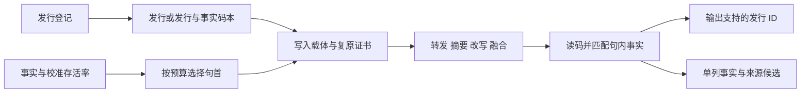

# KBPW 候选机制与受控结果

令发行记录为 (r)，来源为 (s(r))，可定位事实为 (f_i)，公开载体码本为 (C)。每次嵌入使用一个三词引导短语。每份发行预算为两个事件、六个词，所有候选共同使用词级 Jaccard 相似度。码本用固定散列顺序分配无碰撞载体，供本次研究比较。分配公开，任何人都能复制载体。

- M1 在最先两个合格句首重复 (C(r))，检测器从任一载体读出 (r)。
- M1+source 使用相同的标记和预算。检测器要求载体同句与来源中的至少一个事实匹配，作为普通水印加内容核验的对照。
- M2 在同样位置写入 (C(r,f_i))。检测器还需验证同句匹配指定事实，且比第二候选至少高 0.05。
- M3 使用 M2 的绑定码本，在合格位置中选取权重 (w_i\widehat p_i) 最高的两个。(w_i) 按三事实固定为 1、1、2。以校准链中原句存活次数和暴露次数估计 (\widehat p_i=(n_{\mathrm{visible}}+1)/(n_{\mathrm{exposed}}+2))。这个目标是线性选择启发式。它近似加权存活事实数，尚未估计联合存活概率。

```text
encode(release, mode):
    eligible = eligible_fact_starts(release)
    choose first two positions for M1/M2
    choose top two by salience * dev_survival for M3
    insert codeword(release) or codeword(release, fact)
    save offsets and original capitalization for exact inverse

decode(text, mode, tau):
    split into sentences and read visible codewords
    compute each statement's similarity to reference facts
    M1 accepts recognized release codewords
    M1+source requires any same-source similarity >= tau
    M2/M3 require specified fact similarity >= tau and margin >= 0.05
    return unique accepted releases and separately report fact matches
```



## 首批受控对照

相似度定义为 $J(A,B)=|A\cap B|/|A\cup B|$，其中 $A$ 和 $B$ 为去大小写后的词集合。每条查询事实的分数是它与登记的三种参考表述的最大 Jaccard 相似度。M2/M3 的发行判定要求载体对应事实的分数达到阈值，且领先任一其他事实至少 0.05。

12 份 OpenStax 来源、24 次发行、138 校准端点、414 留出端点。发码完整率四组均为 24/24，每组写入 48 次共 144 词，并验证证书能逐字还原。阈值用校准分区选取，以发行 micro-F1 优先，同分选更严格的值。M2/M3 的同句阈值为 0.95。开发分区与测试分区按整条链隔离，底稿族与发行登记共享。分区可控制链路泄漏，仍无法支持来源外推或 1% 误报校准。

- M1、M2、M1+source 各恢复 439/657 个有知识支持的发行 ID，Precision 100%，Recall 66.8%，F1 0.801。第 1、3、5 轮召回分别为 89.6%、57.4%、42.7%。强改写召回 24.7%。
- M3 恢复 448/657，Precision 100%，Recall 68.2%，F1 0.811。第 1、3、5 轮为 90.4%、58.8%、45.0%。多发行集合精确恢复率从 52.1% 到 54.4%。强改写召回从 24.7% 降到 22.8%。
- M1 的七类定向反例出现 4 个无知识支持的发行标签，M1+source、M2、M3 各出现 1 个。剩余反例把有效码字复制到与目标事实一致的独立文档，知识相容但发行继承关系不存在。公开码本与事实相似性的组合无法区分这两种情况。

受控回放在原句被改写时整句替换，因而主网格的零误归因受设定约束。语义保留与身份恢复是独立指标。M3 对具体事实的优先选择仅带来 9 个额外发行命中，强改写组同时退步。本批证据尚不足以确认新算法收益。

复现使用 `python -B experiments/hsw_provenance_next/candidate.py`。同目录保存逐端点预测、已编码发行、定向反例与阈值配置。
