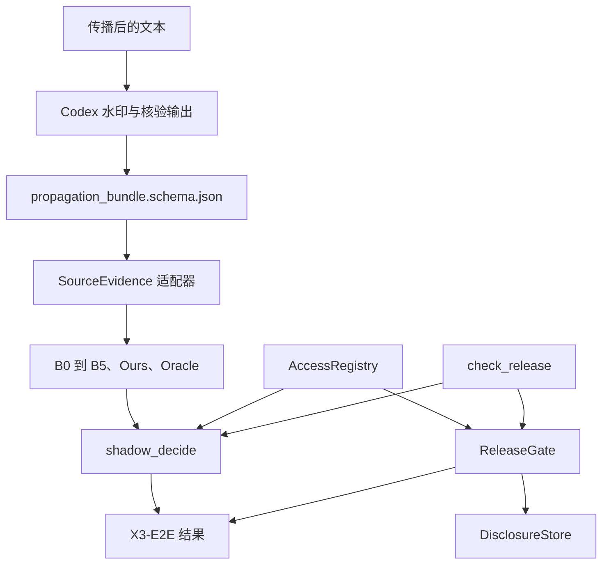

# 来源证据影子路径

生产放行仍是一条路径：`ReleaseGate` 调用 `AccessRegistry.is_authorized` 和 `check_release`，再向 `DisclosureStore` 预留回执。影子路径只读这些判定，不预留、不提交、不替换注册表。

教育案例和软件案例在实验里直接调用图中右侧的 `ReleaseGate`。用的是进程内回执，不打开 MySQL。影子模块的源码不引用 `release_gate`。

Codex 与这条路径只通过 JSON 交接。本仓库不修改 `codex/hsw-st` 上的水印实现。服务器试点文件不在当前克隆里，所以本轮结果没有把受控夹具写成那次试点。
